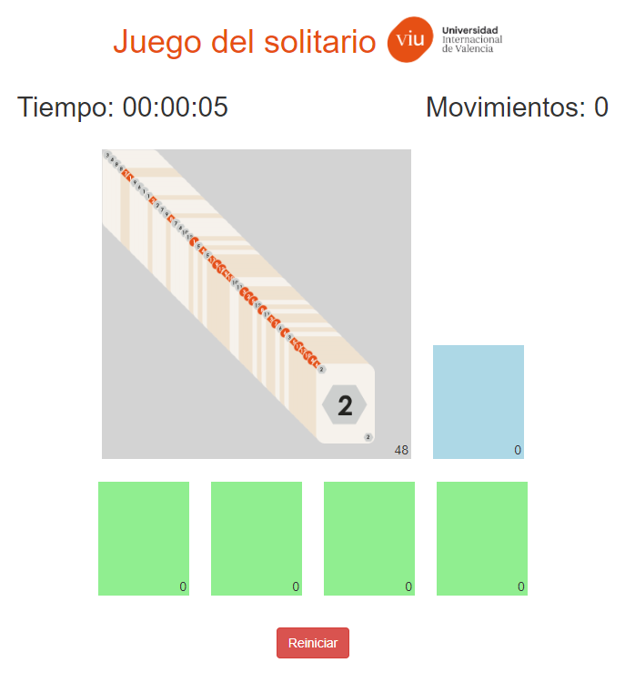
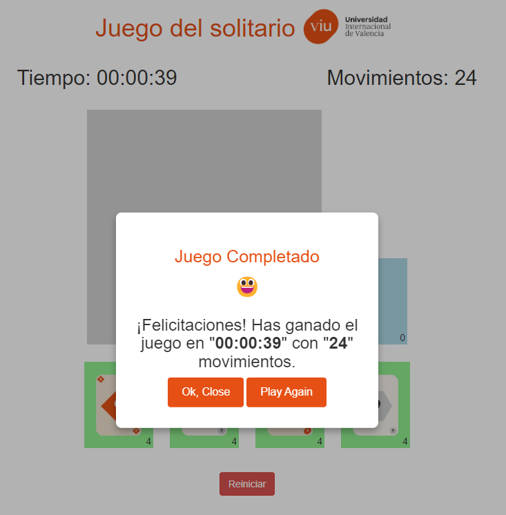

<p align="center"></p>

# Solitario VIU 🃏

A single-player card game that runs in the browser, built with **HTML5 drag and drop**, **CSS** and
**vanilla JavaScript**, with no frameworks. Developed for the Master's in Web Applications and Services Development
at Universidad Internacional de Valencia (VIU).


<p align="center">
  
  
</p>

## How to play

The deck has 48 cards: four suits numbered 1 to 12. The goal is to build each suit on one of the four
foundation piles, **from 12 down to 1**.

1. Drag the top card of the initial pile to a foundation (it must be the next card of that suit) or to the
   discard pile.
2. When the initial pile runs out, the discard pile is shuffled back in.
3. You win when the four foundations are complete.

## Features

- Shuffled deck on every game and drag-and-drop card movement.
- Rule validation on each drop.
- Timer and move counter.
- Restart button and victory message.

## Run it

No build step or dependencies: clone the repository and open `solitario.html` in any modern browser.

```
css/solitario.css   # Board and card styles
js/solitario.js     # Game logic: deck, shuffling, drag and drop, rules, counters
imagenes/baraja/    # Card images
```

## License

[GPL-3.0](LICENSE) © Oscar Cuenca · [LinkedIn](https://www.linkedin.com/in/ocuenca-moreno/)
