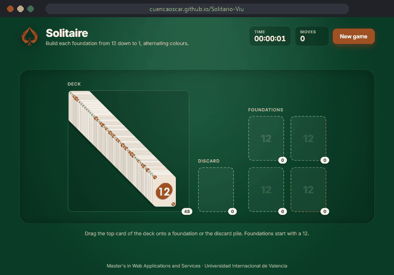
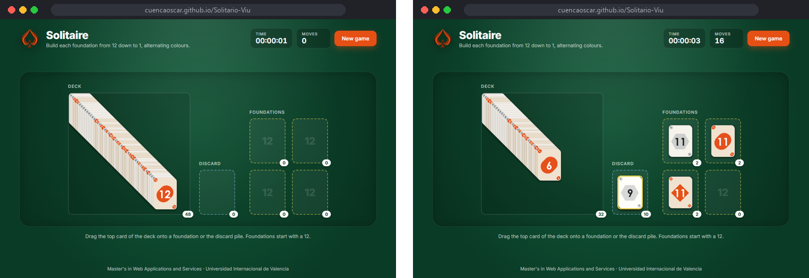

<p align="center"></p>

# Solitario VIU 🃏

A single-player card game that runs in the browser, built with **HTML5 drag and drop**, **CSS** and
**vanilla JavaScript**, with no frameworks. Developed for the Master's in Web Applications and Services Development
at Universidad Internacional de Valencia (VIU).

**▶ Play it online: [cuencaoscar.github.io/Solitario-Viu](https://cuencaoscar.github.io/Solitario-Viu/)**


<p align="center"></p>

## How to play

The deck has 48 cards: four suits numbered 1 to 12, two orange and two grey. The goal is to move every card to
the four foundation piles, each one built **from 12 down to 1 alternating colours**.

1. Drag the top card of the initial pile to a foundation (a 12 starts an empty pile; otherwise it must be one lower
   than the top card and of the other colour) or to the discard pile. The top card of the discard pile can also be
   played to a foundation.
2. When the initial pile runs out, the discard pile is shuffled back in.
3. You win when the four foundations are complete.



## Features

- Shuffled deck on every game and drag-and-drop card movement.
- Rule validation on each drop.
- Timer and move counter.
- Restart button and victory message.

## Run it

Play it at [cuencaoscar.github.io/Solitario-Viu](https://cuencaoscar.github.io/Solitario-Viu/), or clone the repository and open
`solitario.html` in any modern browser (no build step or dependencies).

```
css/solitario.css   # Board and card styles
js/solitario.js     # Game logic: deck, shuffling, drag and drop, rules, counters
imagenes/baraja/    # Card images
```

## License

[GPL-3.0](LICENSE) © Oscar Cuenca · [LinkedIn](https://www.linkedin.com/in/ocuenca-moreno/)
